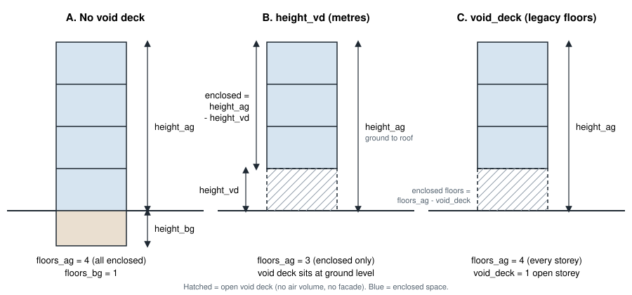

# Building height columns: `height_ag`, `height_vd`, `floors_ag`

The zone geometry (`inputs/building-geometry/zone.shp`) describes a building's vertical extent with
several columns. They interact when a building has a **void deck** - an open, unenclosed portion at
the bottom of the building - so it is worth being precise about what each one includes.



## Definitions

| Column | Unit | What it measures |
|--------|------|------------------|
| `height_ag` | m | Ground to roof. **Always** includes the void deck, if any. |
| `height_vd` | m | Height of the void deck at ground level. Optional, default 0. |
| `floors_ag` | - | With `height_vd`: **enclosed** storeys only. With legacy `void_deck`: **every** storey, void ones included. |
| `void_deck` | - | Legacy. Number of open storeys from the ground up. Superseded by `height_vd`. |
| `height_bg`, `floors_bg` | m, - | Basement. Unaffected by the void deck. |

Where both `height_vd` and `void_deck` are present, `height_vd` wins for any building whose cell
holds a value; a blank cell falls back to `void_deck`.

## Derived quantities

```text
enclosed height  = height_ag - void deck height
storey height    = enclosed height / enclosed floors
```

Never compute a storey height as `height_ag / floors_ag`: that is only correct for a building with
no void deck or on the legacy column, and overstates it for `height_vd`.

## Worked example

A single floor modelled above an existing building (issue #4115): `height_ag` = 20 m,
`height_vd` = 17 m, `floors_ag` = 1, footprint 500 m².

- enclosed height = 20 - 17 = **3 m**
- enclosed volume = 500 x 3 = **1,500 m³** (not 500 x 20 = 10,000 m³)
- facade area = perimeter x 3 m (not perimeter x 20 m)

## Which height each calculation uses

| Calculation | Uses | Why |
|-------------|------|-----|
| Storey height, internal air volume | enclosed height | Air only exists in enclosed space. |
| Dynamic infiltration: volume, facade area, leakage path heights | enclosed height, offset by `height_vd` | The void deck is open and does not leak. Paths sit at their real elevation, which matters for wind-pressure lookup. |
| Domestic hot water riser length | full `height_ag` | The pipe still has to run through the void deck. |
| Electrical pumping height | full `height_ag` | Water is lifted from the ground. |

## For developers

Do not read `floors_ag` or `height_ag` directly where a void deck could matter. Use the resolvers in
`cea/datamanagement/utils`:

```python
resolve_void_height(df)          # void deck height in metres, 0 if none
resolve_enclosed_floors_ag(df)   # storeys that actually enclose space
enclosed_storey_height(df)       # (height_ag - void height) / enclosed floors
```

`*_for_row` variants take the dict returned by `BuildingGeometry[name]`.
